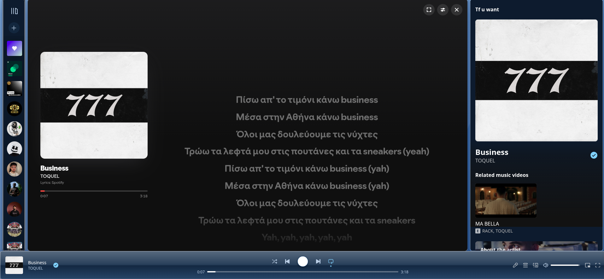
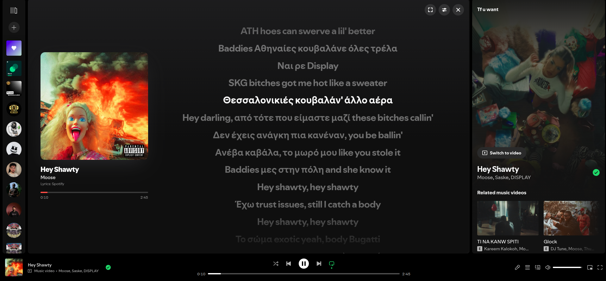

# Wrong-Lyrics?

# Spicetify Extension

A custom extension for [Spicetify](https://spicetify.app/) designed to enhance your Spotify experience.

---

## 📸 Screenshots

| Custom Theme (Blue) | Original Theme |
| :---: | :---: |
|  |  |

> **Note:** Make sure to upload your screenshots to your repository root (or image folder) as `preview-custom.png` and `preview-original.png`!

---

## 🛠️ Installation

Since this extension is written in JavaScript, you can easily install it using the Spicetify CLI.

### Step 1: Download the Extension
Download the `extension.js` file (or clone this repository) and place it into your Spicetify `Extensions` folder.

**Folder Locations:**
* **Linux / macOS:** `~/.config/spicetify/Extensions/`
* **Windows:** `%userprofile%\.spicetify\Extensions\`

### Step 2: Enable the Extension
Open your terminal or command prompt and run:

```bash
spicetify config extensions extension.js
spicetify apply
